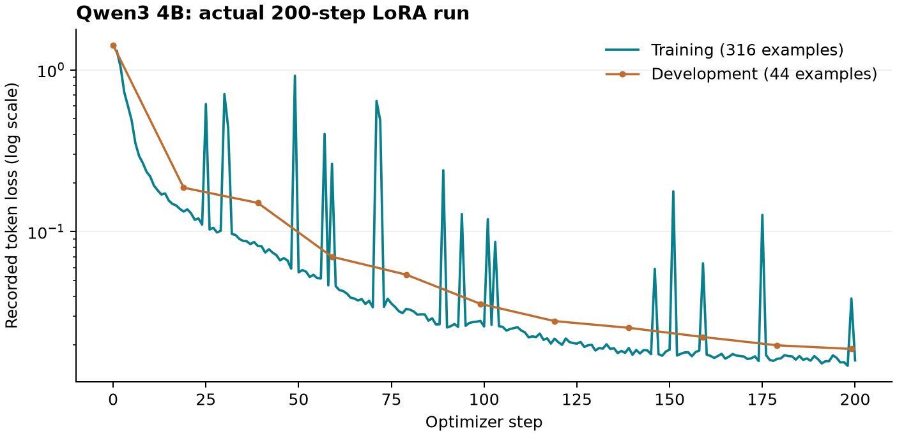

# Mulberry-silk alternatives: local research pilot

Run date: 1 November 2026. The textile reference is mulberry (*Bombyx mori*) silk;
the priorities are feel, drape and lustre. This pilot exercised the app's real
agent tools, retained sources, immutable datasets, local model fitting and
atomistic simulation. It does not establish a silk-equivalent material.

## Source and evaluation design

The property data are the 372-record polyester subset of
[PolyOmics, Ryo Yoshida, Yoshihiro Hayashi and the RadonPy Consortium](https://huggingface.co/datasets/yhayashi1986/PolyOmics),
dataset DOI [10.57967/hf/7475](https://doi.org/10.57967/hf/7475), released under
CC BY 4.0. The associated paper is
[arXiv:2511.11626](https://arxiv.org/abs/2511.11626). The retained dataset/card
revision is `cbab9483395a32dd968fbeb047808031fb0f3a13`.

These are externally computed amorphous-polymer properties, not experimental
textile measurements. Original CSV bytes, checksums, polymer identifiers,
repeat-unit SMILES, calculation metadata and 300 K/1 atm conditions were retained.
Density and refractive-index models use identical grouped partitions: 298
training, 37 development and 37 final structures. Final outcomes were not used
for further tuning.

The assistant dataset contains 360 source-record extraction tasks and 40 teaching
examples from actually executed app-tool calls. Its origin remains synthetic.
The frozen split has 316 training, 44 development and 40 final examples. The final
set represents 18 polymer-record groups and one tool-request group; the four tool
examples are paraphrases of that one request. This is a narrow interface/task
test, not an independent materials-reasoning or broad agent benchmark.

## Qwen3 4B fine-tune

Base: `mlx-community/Qwen3-4B-Instruct-2507-4bit`, Apache 2.0, revision
`50d427756c6b1b2fe0c0a10f67fbda1fc8e82c1b`. Downloaded weights were checked against
the Hugging Face SHA-256 manifest, including the required chat-template file.

A real 10-step feasibility run completed before a fresh 200-step run from the
base. Both used MLX, rank-8 LoRA, batch size 1, a 1,024-token limit, learning rate
`1e-5` and seed 42. The main run saved every 20 steps and trained 16,515,072
parameters in 370 seconds. Peak MLX memory was 6.25 decimal GB (about 5.82 GiB).
Training loss changed from 1.3103 to 0.01601; development loss changed from 1.4245
to 0.01885. Final examples were excluded from training requests and loaders.

Lower token loss is an optimization observation, not evidence of improved
materials science or textile performance.

### Frozen final results and a format defect

The retained raw evaluation remains unchanged. The adapter prefixed its 36
record answers with an **empty** `<think></think>` block. Consequently it failed
the original bare-JSON parser even when the following JSON values were correct.
The app now removes only that empty protocol prefix for visible local inference;
it does not discard a nonempty reasoning body to make an answer pass.

The table separates strict raw formatting from a deterministic review of the
same archived outputs after this empty-prefix normalization. No model weights,
hyperparameters or training examples changed after final evaluation.

| Check | Base | Adapter |
| --- | ---: | ---: |
| Raw string exact match | 0/40 | 0/40 |
| Raw strict JSON-only records | 36/36 | 0/36 |
| Structured JSON after empty-prefix normalization | 36/36 | 36/36 |
| JSON reference values after normalization | 35/36 | 36/36 |
| Numeric values and units after normalization | 36/36 | 36/36 |
| Supported citation IDs after normalization | 36/36 | 36/36 |
| Native tool request variants | 0/4 | 4/4 |

Citation-ID matching does not prove that a source entails a claim. Passing four
variants of one held-out tool request does not demonstrate general tool-use
competence. The candidate remains inactive; activation requires human review.

The raw evaluation artifact SHA-256 is
`d697c8a283b51e2f3abb7feee961e4b45673139e29e1417397f8bd6e31189e01`.
The local framing-audit artifact is retained under `.runtime/evidence/` with
SHA-256 `393b679ac4cdbd75c906e0b66507106534a0b0a3f6b009cb7dae97b4aa8bb382`.

## Property-model fits

Each fit used Chemprop 2.3.1, two ensemble members, 30 epochs, hidden dimension
64, depth 2, batch size 32 and seed 42. The engine's fixed optimizer schedule was
used: `1e-4 → 1e-3 → 1e-4`, with two warm-up epochs. The baseline uses the training
partition mean only.

| Final-set property | Model MAE | Baseline MAE | Model RMSE | Baseline RMSE |
| --- | ---: | ---: | ---: | ---: |
| Density, g/cm³ | 0.04450 | 0.05421 | 0.05243 | 0.06933 |
| Refractive index, dimensionless | 0.01794 | 0.06251 | 0.02271 | 0.07315 |

Both improve on their baseline on these 37 final structures. The structural
coverage flag was positive for all 37 at an uncalibrated Morgan/Tanimoto threshold
of 0.25. This flag is not a calibrated error bound. These fits predict the
declared computational endpoints; neither predicts fabric hand, drape or lustre.

### Structure-only screening

Both trained models were actually run on a separate, frozen, six-row dataset
containing structures without target labels. The following values are predictions,
not additional measured or independently validated data.

| Repeat structure | Predicted density, g/cm³ | Predicted refractive index | Exact graph in fitting data? |
| --- | ---: | ---: | --- |
| PET | 1.24902 | 1.57840 | Yes, training row 165 |
| PTT | 1.21410 | 1.56814 | Yes, training row 107 |
| PDEGT | 1.22801 | 1.55271 | Yes, training row 9 |
| PTEGT | 1.21264 | 1.53403 | Yes, training row 10 |
| PDEGF | 1.28509 | 1.52275 | No exact canonical-identity match |
| PDEGI | 1.22757 | 1.55235 | Yes, training row 224 |

Five of six structures are retrospective predictions on graphs already present
in the training partition. They provide no new evidence of generalization or
chemical novelty. PDEGF's nearest training Morgan/Tanimoto similarity is 0.9032;
all six pass the uncalibrated 0.25 coverage flag. Ensemble sample variances range
from 1.19e-6 to 5.09e-5 (g/cm³)² for density and 8.85e-10 to 3.66e-7 for refractive
index. Two-member ensemble variance is not a calibrated predictive interval.
There is no validated silk-distance objective with which to rank this table.

## Material hypotheses and physical validation

The practical register contains fine-denier PET, rounded-trilobal PET with
controlled filament layout, PET surface/weight-reduction treatments, PTT or
PET/PTT construction, and hydrophilic PEG-modified polyester. These are material
and process routes to compare, not demonstrated improvements in silk proximity.

The chemistry register contains ether-enriched terephthalate (PDEGT), a longer
ether spacer (PTEGT), a PET-rich adipate copolymer, an ether/furan polyester and
an ether/isophthalate isomer. “Exploratory” describes this screen; no chemical or
patent novelty is claimed. An unspecified copolymer sequence is not represented
as a fictitious single repeat.

The selected atomistic comparison is PET
`*OCCOC(=O)c1ccc(C(=O)*)cc1` versus PDEGT
`*OCCOCCOC(=O)c1ccc(C(=O)*)cc1`. PDEGT tests one additional ether-containing
spacer as a homopolymer limit, rather than a low-comonomer random copolyester.

### Actual atomistic pilot results

Both matched two-seed jobs completed with real RadonPy 0.2.11 and native ARM64
LAMMPS 2025.7.22.4.0. Every atom received GAFF2 parameters and finite Gasteiger
charges. Each cell contains four capped eight-repeat chains. Both seeds ran
packing, all 21 compression/decompression stages at a 0.01 protocol scale, and
50,000 NPT steps at 1 fs (50 ps), targeting 300 K and 1 atm.

| Material | Atoms/cell | Seed | Density, g/cm³ | Temperature, K | Mean pressure, atm |
| --- | ---: | ---: | ---: | ---: | ---: |
| PET | 740 | 1729 | 1.21951 | 300.35 | −47.94 |
| PET | 740 | 1733 | 1.19630 | 299.25 | 47.00 |
| PDEGT | 964 | 1729 | 1.18009 | 299.48 | 91.43 |
| PDEGT | 964 | 1733 | 1.19340 | 300.03 | −14.14 |

These are retained short-window diagnostics, not equilibrium material constants.
Every seed was numerically stable, failed RadonPy convergence, and remains
**ineligible for training labels**. The shortened protocol alone also prevents
eligibility. The pressure means illustrate substantial residual fluctuations.
Neither the density difference nor the temperature control establishes a better
fiber, fabric or silk substitute.

PET completed in 628 cumulative wall-clock seconds. PDEGT initially completed
its second seed's 50,000 integration steps but exited with code 15 during native
MPI finalization. That attempt remained failed, and its original logs, outputs,
failure context and SHA-256 manifest were archived. One app-agent recovery reused
the completed first seed and restarted only the second seed's final sampling
stage from the completed stage-2 molecule checkpoint. The recovery exited cleanly
with code 0; PDEGT's cumulative time, including the failed attempt, was 1,100
seconds within its unchanged 3,600-second cap. No chemistry, force field, MPI
configuration or protocol was silently changed. All original and recovery
trajectories, restart files, stage checkpoints and engine diagnostics remain
available through the private simulation artifacts.

Retained textile context includes the primary
[silk-like fabric optical comparison](https://www.jstage.jst.go.jp/article/jte1955/30/1/30_1_18/_pdf),
[polyester cross-section study](https://dergipark.org.tr/en/download/article-file/1286162)
and [fiber-friction study](https://www.jstage.jst.go.jp/article/fiber1944/41/5/41_5_T211/_pdf).
A modified-polyester fabric paper was retained from a public mirror after the
publisher returned HTTP 403; its mirror origin remains explicit in the app.
The requested NISCIR silk/KES and MDPI ether-copolyester files could not be
retained during this run, so their uninspected full text is not used as evidence.
Public accessibility was not treated as a grant of training rights.

A silk-proximity test requires a measured mulberry control at matched fabric
construction, basis weight, colour and conditioning. Bending/shear, surface
friction/roughness, direct drape and angle-resolved reflection remain distinct
unmeasured endpoints. Repeat-unit density or refractive index cannot replace them.

## Saved campaign and review

The campaign is saved as **Mulberry-silk alternatives** in chat history and its
private notebook. The final recovery/comparison draft and source-linked research
memory preserve completed work, failed attempts, limitations and the next
physical tests. The fine-tuned assistant remains inactive pending human review.
No additional training followed the frozen final evaluation.

The app's conservative paid-provider ledger totals **US$5.141796**, below the
approved US$20 cap; retained reservations for failed requests can differ from a
provider invoice. The separate four-hour training/evaluation and four-hour
simulation caps were retained. Original public sources and citation metadata
remain in the app's Downloads archive; model checkpoints, immutable datasets and
raw scientific artifacts remain in the private vault. Native artifact exports
use `~/Downloads/Chemistry Studio/Artifacts/`.

Reconciled compute usage is 723.35 seconds for training, evaluation and prediction,
and 1,728.34 seconds for simulation, including the failed attempt and recovery.
The model downloads used a separate 163.20 seconds. The campaign links ten
retained sources, five immutable datasets, five model records, eleven notebook
pages and two continuity memories. All ten original source checksums matched
their retained bytes. The two MD directories contain 353 individually hashed
files (77.1 MB), including 13 XTC trajectories and 26 restart files across
current and archived attempts. No source or scientific output was evicted during
cache and stale-release cleanup.
